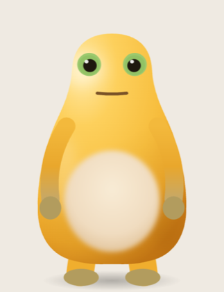

# 更新记录

## v0.7.0 — Windows 适配

- 平台分支：`screen-saver` 窗口层级、`setVisibleOnAllWorkspaces` 只在 macOS 调，
  Windows 走普通 `setAlwaysOnTop(true)`（Windows 不认层级参数）
- 穿透开关在 Windows 上带 `{ forward: true }`，macOS 保持裸调用
- **修**：音频路径改用 `pathToFileURL()`。之前是 `'file://' + encodeURI(p)`，
  在 Windows 上会拼成 `file://C:%5C...` 这种非法 URL，自定义声音直接失效
- 菜单字体加 `Segoe UI` / `微软雅黑`，中文不再走奇怪的兜底字体
- `npm run pack:win`：交叉打 Windows 免安装包（x64 zip）。顺手把 exe 图标和
  「属性 → 详细信息」里的 Electron 换成奶蛙桌宠（`resedit` 直接改 PE 资源）

## v0.6.0 — 四个声音槽，以及修掉 v0.5.0 的音效 bug

- 笑一个 / 点一下 / 落地 / 喝奶茶，四个槽位都能换成自己的音频
- 音频目录改到 `~/Library/Application Support/奶蛙桌宠/sounds/`。往签名过的 `.app`
  里写文件会让签名失效，Apple Silicon 上可能直接起不来
- 菜单「换声音…」直接打开那个目录；首次运行自动建目录并放一份说明
- **修**：v0.5.0 里 `sfxPoke` / `sfxLand` / `sfxSlurp` 三个函数在重写音频段时被误删，
  点击、落地、喂奶茶都会抛 `is not defined` —— 表现是点一下没有爱心滑出，
  喂奶茶只有杯子动画、饱腹感不涨。v0.5.0 的 DMG 有这个问题，请用 v0.6.0

## v0.5.0 — 打成能双击的 App

- `tools/pack.sh`：手拼 `Electron.app` → `NaiwaPet.app`，不依赖 electron-builder
- `tools/make-icon.js`：用 Electron 自己渲染图标（`sips` 转 SVG 会丢 alpha）
- `npm run pack` / `npm run icon`

## v0.4.0 — 笑声可替换

- 扫描 `assets/sounds/laugh.*`，命中就用真声，动画时长跟着音频长度走
- 菜单加「换笑声…」，直接打开那个文件夹，丢完不用重启
- 合成音退回单带通版本。中途试过三共振峰 + 混响，听感太诡异，撤了

## v0.3.1 — 三个交互 bug

- **小/中/大 点了没反应**：`resizable:false` 的窗口在 macOS 上会吞掉 `setBounds` 的尺寸变化
- **菜单点了不出效果**：宠物漫游时会走开 + 菜单按钮落在命中椭圆外被判成空白区穿透 + 主进程关菜单没通知渲染层
- **朝左走时 HFI 变 IHF**：整体 `scaleX(-1)` 把字也翻了

## v0.3.0 — 校服

- HFI 深蓝 polo：领子、门襟、两颗扣子、左胸刺绣
- 短袖用同一条手臂路径 + `stroke-dasharray` 只画前 40%，袖口自然垂直于手臂

## v0.2.0 — 造型推翻重画

初版是大头圆团 + 大眼，跟本体完全不像。对着实拍图重画：

- 梨形身体、**没有脖子**、头身一体
- 眼睛很小、分得极开、贴着头顶两侧，绿眼珠黑瞳孔
- 米白奶油色肚皮、橄榄色手脚、黏土质感的柔和渐变

## v0.1.0 — 能跑起来

- 透明置顶无边框窗口，`focusable:false` 不抢焦点
- 60Hz 轮询光标做命中测试，命中区外点击穿透
- 拖拽 / 自由落体 / 落地挤压 / 沿底边漫游
- 分层 SVG + CSS transform 的状态机动画（呼吸、眨眼、走路、被拎起、睡觉）
- 右键菜单：心情饱腹、笑一个、喂奶茶、去睡觉、自己走走、大小、声音、退出
