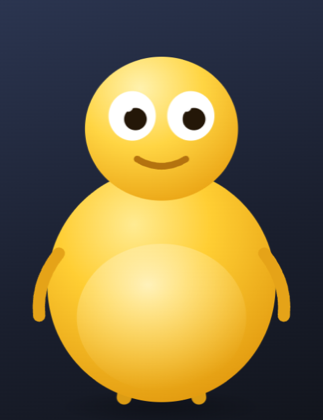

# 更新记录

## v0.5.0 — 打成能双击的 App

- `tools/pack.sh`：手拼 `Electron.app` → `NaiwaPet.app`，不依赖 electron-builder
- `tools/make-icon.js`：用 Electron 自己渲染图标（`sips` 转 SVG 会丢 alpha）
- `npm run pack` / `npm run icon`

## v0.4.0 — 笑声可替换

- 扫描 `assets/sounds/laugh.*`，命中就用真声，动画时长跟着音频长度走
- 菜单加「换笑声…」，直接打开那个文件夹，丢完不用重启
- 合成音退回单带通版本。中途试过三共振峰 + 混响，听感太诡异，撤了

## v0.3.1 — 三个交互 bug

- **小/中/大 点了没反应**：`resizable:false` 的窗口在 macOS 上会吞掉 `setBounds` 的尺寸变化
- **菜单点了不出效果**：宠物漫游时会走开 + 菜单按钮落在命中椭圆外被判成空白区穿透 + 主进程关菜单没通知渲染层
- **朝左走时 HFI 变 IHF**：整体 `scaleX(-1)` 把字也翻了

## v0.3.0 — 校服

- HFI 深蓝 polo：领子、门襟、两颗扣子、左胸刺绣
- 短袖用同一条手臂路径 + `stroke-dasharray` 只画前 40%，袖口自然垂直于手臂

## v0.2.0 — 造型推翻重画

初版是大头圆团 + 大眼，跟本体完全不像。对着实拍图重画：

- 梨形身体、**没有脖子**、头身一体
- 眼睛很小、分得极开、贴着头顶两侧，绿眼珠黑瞳孔
- 米白奶油色肚皮、橄榄色手脚、黏土质感的柔和渐变

## v0.1.0 — 能跑起来

- 透明置顶无边框窗口，`focusable:false` 不抢焦点
- 60Hz 轮询光标做命中测试，命中区外点击穿透
- 拖拽 / 自由落体 / 落地挤压 / 沿底边漫游
- 分层 SVG + CSS transform 的状态机动画（呼吸、眨眼、走路、被拎起、睡觉）
- 右键菜单：心情饱腹、笑一个、喂奶茶、去睡觉、自己走走、大小、声音、退出
