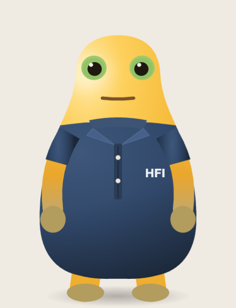
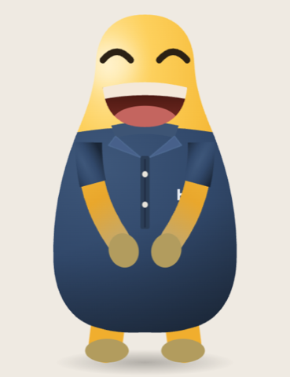
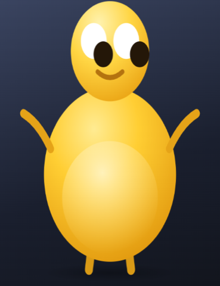
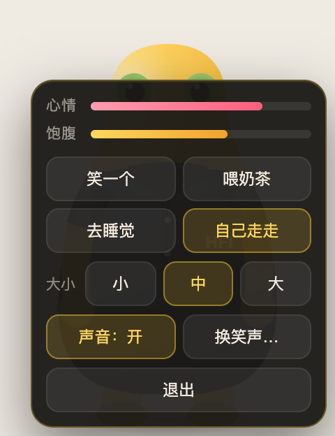
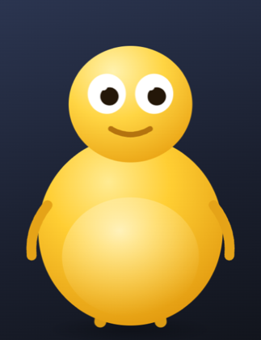
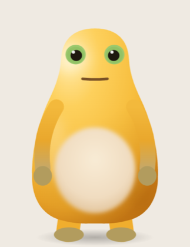
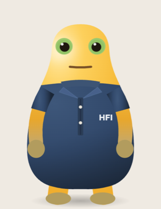

# 奶蛙桌宠 · Naiwa Desktop Pet

一只会自己走动、能拖着玩、还会穿 HFI 校服的奶蛙，住在你的 macOS 桌面上。

   

> 上面四张是真实运行截图（站立 / 大笑 / 被拎起 / 右键菜单），不是示意图。

## 跑起来

**方式一：双击 App（推荐，不依赖终端）**

从 [Releases](../../releases) 下 `NaiwaPet-0.5.0-arm64.dmg`，打开拖进「应用程序」就行。
想开机自启：系统设置 → 通用 → 登录项 → 加号 → 选它。

自己构建：

```bash
npm run pack          # 生成 dist/NaiwaPet.app
open dist/NaiwaPet.app
```

**方式二：开发模式**

```bash
npm start
```

> 如果在受限沙箱里跑报 `sandbox initialization failed`，加 `--no-sandbox`；
> 在自己的 Terminal.app 里直接跑不会有这个问题。

改完代码想更新 App，重新 `npm run pack` 即可（会覆盖 `dist/NaiwaPet.app`）。

## 版本

见 [CHANGELOG.md](CHANGELOG.md)。造型改过两轮，中间那版的对比在图里：

 →  → 

## 怎么玩

| 操作 | 效果 |
|---|---|
| 左键按住拖 | 把它拎起来（身体会拉长），松手自由落体，落地会「啪」一下压扁再弹回 |
| 单击 | 蹦一下 + 「啾」一声 + 冒爱心，心情 +2 |
| 右键 | 打开菜单（心情 / 饱腹条、笑一个、喂奶茶、去睡觉、自己走走、大小、声音、退出） |
| 不管它 | 过几秒会自己在屏幕底边走来走去，走累了停下 |

- **笑一个**：张嘴大笑，眼睛笑成两条弧，双手抱住肚子，配一段现场合成的「哈哈」笑声。
- **喂奶茶**：一杯奶茶飘到嘴边，吸溜三口，饱腹 +26、心情 +8。
- **去睡觉**：闭眼、飘 Zzz、呼吸变慢。
- **大小**：小 / 中 / 大，位置和设置会存到 `~/Library/Application Support/naiwa-pet/pet-settings.json`。

## 声音

内置的音效（笑、点一下、落地、喝奶茶）都是 WebAudio 现场合成的，能听但不像原声。
四个都能换成你自己的音频，**不用改代码也不用重新打包**：

1. 右键桌宠 →「换声音…」，打开音频文件夹
2. 丢一个 `laugh.mp3` 进去（还可以有 `poke` / `land` / `feed`）
3. 再开一次菜单，就换上了

完整教程（哪找音频、怎么转格式、多长合适、不生效怎么查）见
**[docs/CUSTOM-SOUND.md](docs/CUSTOM-SOUND.md)**。

> 音频放的是 `~/Library/Application Support/奶蛙桌宠/sounds/`，不在 `.app` 里面 ——
> 往签名过的 app 包里塞文件会让签名失效，在 Apple Silicon 上可能直接启动不了。

## 实现要点

- **透明窗口**：`transparent + frame:false + hasShadow:false + focusable:false`，点击不抢当前 App 的焦点。
- **点击穿透**：主进程 60Hz 轮询 `screen.getCursorScreenPoint()`，光标在身体椭圆内就 `setIgnoreMouseEvents(false)`，否则放行给下层窗口。macOS 上没有 Windows 那个 `forward` 选项，只能靠轮询。
- **位置物理**：窗口位置由主进程独占，renderer 只负责表情。走路 / 重力 / 拖拽全在 `main.js` 的 `tick()` 里。
- **角色**：一张分层 SVG（`renderer/index.html`），不是逐帧图。所有动作都是 CSS `transform`：
  呼吸 = 整体 `scale(1.02, 0.98)`；落地 = `squash & stretch`；拖拽 = `scale(0.86, 1.18)` + 举胳膊。
  改一个数字就能调手感，比画 200 帧省事一个数量级。
- **音效**：WebAudio 现场合成（锯齿波 + 带通共振腔做「哈」，正弦下扫做落地「咚」），仓库里没有任何音频文件。

## 改它

| 想改什么 | 去哪 |
|---|---|
| 造型、颜色、五官 | `renderer/index.html` 里的 `<defs>` 渐变 + `<g id="bodygroup">` |
| 动画手感 | `renderer/pet.css` 里的 `@keyframes`，以及 `.state-*` 规则 |
| 走路速度 / 重力 / 待机时长 | `main.js` 顶部的常量（`WALK_SPEED`、`GRAVITY`、`TICK`） |
| 命中区域（点哪儿算点到它） | `main.js` 的 `hitTest()` |
| 菜单项 | `renderer/index.html` 的 `#menu` + `main.js` 的 `pet:cmd` switch |

## 版权

奶蛙 / 奶龙 的二创形象版权归属复杂：奶龙是深圳第七印象的注册 IP，奶蛙是网友从 AI 生成翻车图里养出来的梗，没有官方授权。

**自己电脑上玩没有任何问题，但请不要打包分发或上架**。这个仓库里只有代码和手绘 SVG，没有一张官方素材。
